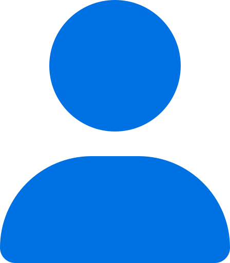
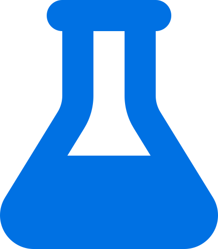
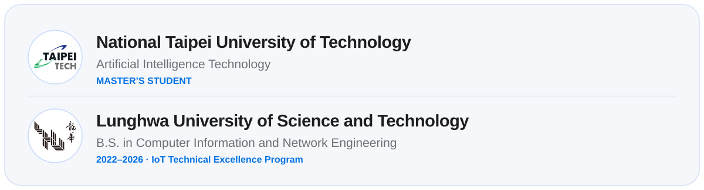
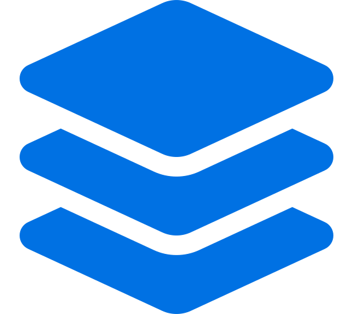

<picture>
  <source media="(prefers-reduced-motion: reduce) and (prefers-color-scheme: dark) and (max-width: 600px)" srcset="assets/profile/hero-still-mobile-dark.svg">
  <source media="(prefers-reduced-motion: reduce) and (max-width: 600px)" srcset="assets/profile/hero-still-mobile-light.svg">
  <source media="(prefers-reduced-motion: reduce) and (prefers-color-scheme: dark)" srcset="assets/profile/hero-still-dark.svg">
  <source media="(prefers-reduced-motion: reduce)" srcset="assets/profile/hero-still-light.svg">
  <source media="(prefers-color-scheme: dark) and (max-width: 600px)" srcset="assets/profile/hero-mobile-dark.svg">
  <source media="(max-width: 600px)" srcset="assets/profile/hero-mobile-light.svg">
  <source media="(prefers-color-scheme: dark)" srcset="assets/profile/hero-dark.svg">
  
</picture>

  <a href="https://roy.emo-lab.com"><picture><source media="(prefers-color-scheme: dark)" srcset="assets/profile/website-dark.svg"></picture></a>
  <a href="https://roy.emo-lab.com/en/cv"><picture><source media="(prefers-color-scheme: dark)" srcset="assets/profile/cv-dark.svg"></picture></a>
  <a href="https://scholar.google.com/citations?user=DPnS2ZUAAAAJ&amp;hl=zh-TW"><picture><source media="(prefers-color-scheme: dark)" srcset="assets/profile/scholar-dark.svg"></picture></a>
  <a href="https://www.linkedin.com/in/yu-cheng-lung-620957381"><picture><source media="(prefers-color-scheme: dark)" srcset="assets/profile/linkedin-dark.svg"></picture></a>
  <a href="mailto:lyc@mail.emo-lab.com"><picture><source media="(prefers-color-scheme: dark)" srcset="assets/profile/email-dark.svg"></picture></a>

 

##  &nbsp; About

I work across **computer vision, AI, and embedded systems**—turning research questions into testable, demonstrable prototypes.

我從電腦視覺、人工智慧與嵌入式系統出發，把研究問題做成可測試、可展示的原型。

My research focuses on **sign-language recognition, multimodal AI, MCP + LLM applications, and embedded interactive systems**.

 

##  &nbsp; Selected Work

### [Real-time sign spelling and translation](https://roy.emo-lab.com/en/projects/sign-language)

YOLO + skeletal recognition for real-time sign spelling and translation. IEEE ICCBE 2025 · Best Conference Paper

### [Metro Hackathon — MCP + LLM](https://roy.emo-lab.com/en/projects/metro-mcp)

MCP + LLM applications for passenger assistance services. 2025 Taipei Metro Hackathon · Runner-up

### [Factory safety pose and helmet recognition](https://roy.emo-lab.com/en/projects/factory-safety-vision)

A workplace safety prototype built with OpenPose, YOLO, and CNN.

### [AI smart fishing rod](https://roy.emo-lab.com/en/projects/smart-fishing-rod)

ESP32 vibration sensing with ThingSpeak alerts.

[Full publication list →](https://roy.emo-lab.com/en/publications)

 

##  &nbsp; Education

<picture>
  <source media="(prefers-color-scheme: dark) and (max-width: 600px)" srcset="assets/profile/education-mobile-dark.svg">
  <source media="(max-width: 600px)" srcset="assets/profile/education-mobile-light.svg">
  <source media="(prefers-color-scheme: dark)" srcset="assets/profile/education-dark.svg">
  
</picture>

學歷文字版 · Education details

- **Master's student** in Artificial Intelligence Technology, [National Taipei University of Technology](https://www.ntut.edu.tw/)
- **B.S.** in Computer Information and Network Engineering · IoT Technical Excellence Program, Lunghwa University of Science and Technology (**2022–2026**)

 

##  &nbsp; Highlights

**IEEE ICCBE 2025 · Best Conference Paper** Vision-based real-time sign spelling.

**WASN 2025 · Honorable Mention Student Paper** Multimodal sign-language translation.

**2025 Taipei Metro Hackathon · Runner-up** Passenger assistance with MCP + LLM.

**2025 7th Green Idea Invention and Design Fair · Titanium Prize**

 

##  &nbsp; Tech Stack

### Operating Systems & Platforms

### AI & Machine Learning

### IoT & Hardware

 

<strong>GitHub Activity</strong>

[Contribution activity](https://github.com/eqwgeryfgbdf?tab=overview) · [Repositories](https://github.com/eqwgeryfgbdf?tab=repositories)

 

---

  <strong>Turning research questions into testable prototypes.</strong> 
  將研究問題轉化為可測試的原型

  <a href="https://roy.emo-lab.com">Website</a> ·
  <a href="https://roy.emo-lab.com/en/publications">Publications</a> ·
  <a href="https://gitlab.com/roylung">GitLab</a> ·
  <a href="mailto:lyc@mail.emo-lab.com">Get in touch</a>

<!-- Switched profile view counters on 2026-10-20. Previous Komarev total: 570; the new counter starts fresh. -->

  

自動更新時間

<!-- DAILY-UPDATE:START -->
最後更新：2026-09-21 18:35 (Asia/Taipei)
<!-- DAILY-UPDATE:END -->

